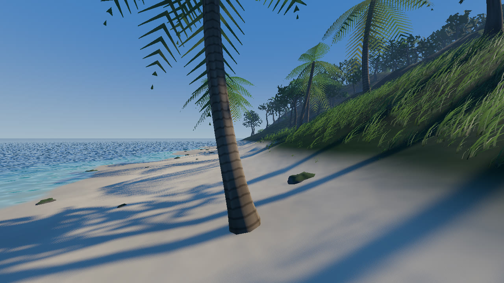
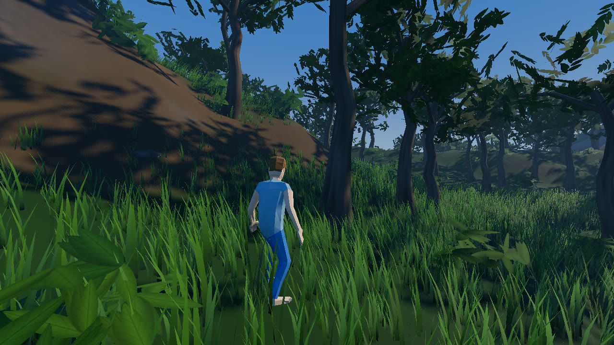
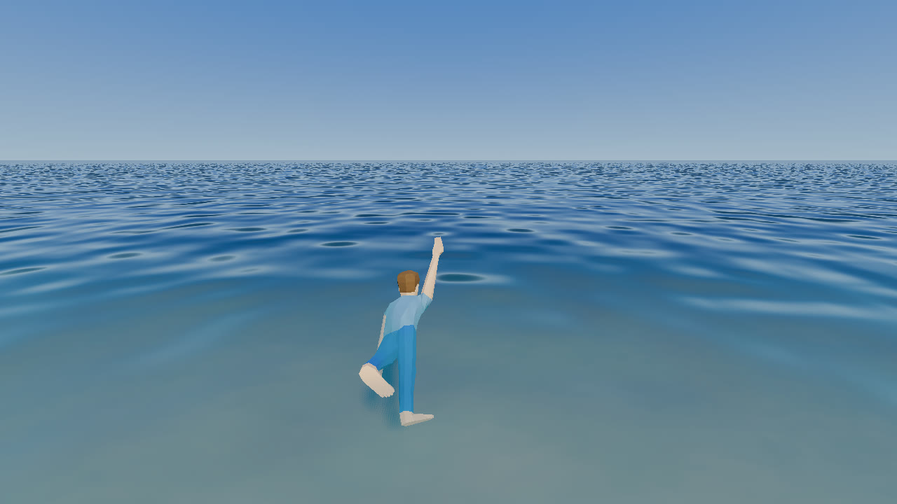

# Outbound

A third-person exploration prototype built with **Godot 4.7**: a procedurally generated tropical
island with eroded mountains, beaches, jungle, wildlife ambience and a swimmable ocean.



| | |
|---|---|
|  |  |

## Features

- **Procedural island**: built from layered noise, droplet-based hydraulic erosion, flattened
  beaches and lagoons, and a seabed that drops away into open ocean.
- **Lake and river**: a hillside lake drains through a meandering river, with flowing ripples
  and white water on the rapids, down to a delta on the beach. You can swim in the lake, and
  the river's current carries you along.
- **Waterfall**: a second stream leaves the lake westward through a rocky gorge and plunges
  27 m off the western cliffs into the lagoon, with mist and foam at the base and a roar you
  can hear from the beach.
- **Secret grotto**: swim in behind the waterfall's curtain to a hidden ledge, and a tunnel
  leads into a chamber of softly glowing crystals around a still pool, with water dripping
  and echoing.
- **Islet**: a small, low, sandy island (0.3× the main island's area) across ~160 m of
  deep sea to the west-south-west, with a few palms and grassy dunes. Its beach looks
  straight at the waterfall.
- **Sky**: a sky gradient with soft fair-weather clouds that drift slowly with the wind and
  catch the light around the sun.
- **Vegetation**: coconut palms on the shore, rainforest trees, big-leaf undergrowth, scattered
  rocks and a dense GPU grass field around the player. Many of the beach palms carry bunches of
  green coconuts, with more lying in the sand underneath. Walk up to a fallen coconut and press
  E: the player steps over, bends down and picks it up; it grows back after a while. Some of
  the bushes carry bunches of red berries (with the odd unripe green one): press E at one to
  pick a handful, and the bush fruits again later. Some rainforest trees bear mangoes or
  oranges, hanging in clusters under the canopy: knock them down with a stone (see below).
  It all sways in shared wind, and every
  mesh and leaf texture is generated in code.
- **Gathering and the hotbar**: gather loose rocks with E for 3–10 stones each. Gathered
  tools and materials fill a six-slot hotbar (keys 1–6; press a slot's key again to put it
  away). Holding stones, an aiming dot appears; click and the player turns and throws one
  overhand where it points, even on the move (the dot is ringed when a fruit bunch is lined
  up): hit a bunch of coconuts, mangoes or oranges and the fruit falls, to pick up with E.
  A stone landing near
  gulls sends them off.
- **Seabirds**: flocks of gulls circle over the coasts, the cliffs by the waterfall and the
  islet, gliding and banking with bursts of flapping, and calling now and then. More gulls
  stand about on the beaches, walking and pecking at the sand. Get too close and they take
  off with an alarm call, then land on another beach a little later.
- **Third-person character**, with controls in the style of GTA V: an over-the-shoulder camera,
  walk, jog and sprint, jumping, and a first-person toggle.
- **Swimming**: wade into the shallows, then swim in deep water. The character treads water when
  still, swims breaststroke (head up, breathing on each pull) when moving, and switches to a
  faster front crawl (with body roll and breathing) while you hold Shift.
- **Sound**: surf from the nearest shoreline, birdsong in the forest and wind at altitude.
  Footsteps match the ground (grass, sand, stone or water), and there are splashes and swim strokes.
- **Footprints in the sand** that fade away after a few seconds.
- **Splashes**: running or wading through shallow water kicks up spray and leaves spreading
  foam rings; jumping in makes a bigger splash, and each front-crawl stroke splashes where the
  hand goes in (breaststroke washes forward with both hands).
- **Crafting and building**: craft a palm-frond lean-to shelter and place it anywhere dry and
  level enough. A preview shows green where it fits and red where it doesn't. On a slope the
  downhill posts stretch to reach the ground. Gathering isn't in yet, so building is free for
  now.
- **Radio**: set your transistor radio down from the Craft page (it tilts to sit on a slope
  and the grass around it gets trimmed). Face it and open the interaction menu to switch it on
  or off, skip to the next song (it plays its playlist in order), or pick it up to move it.
- **Interaction menu** (M), like GTA Online's: Map, Craft, plus actions for what's in front of
  you, such as taking down a shelter you face, which refunds its cost. Nothing is on screen
  until you open it.
- **Map**: a shaded map of the island with contour lines, rivers, your position and facing,
  and your shelters, plus your coordinates, elevation and compass bearing. The game pauses
  while it's open; scroll to zoom in around you.
- **Compass**: a bar at the top of the screen shows the direction you're facing (N, NE, E…
  and the bearing in degrees), with markers for your shelters and radio and how far away
  they are.

## Running

1. Install [Godot 4.7](https://godotengine.org/download) (standard build, Forward+ renderer).
2. Open `project.godot` in Godot and press **F5**. The main scene is `scenes/world_generator.tscn`.

The island loads from the baked files in `world/`, so startup is quick.

## Controls

| Key | Action |
|---|---|
| W A S D / arrow keys | Move (relative to the camera) |
| Mouse | Look / orbit camera |
| Shift | Sprint (or swim front crawl) |
| Alt / Option | Walk |
| Space | Jump |
| V | Toggle first / third person |
| C | Sit down on the ground / get up (moving or jumping also gets up) |
| E | Pick up / gather (when a prompt shows) |
| 1–6 | Hotbar: hold that slot's item; the same key again puts it away |
| Click | Throw a stone (while holding stones) |
| M | Interaction menu: scroll (mouse wheel or two-finger trackpad) selects, click confirms, right-click goes back |
| Click / Right-click | Build / back to the menu, while placing |
| Scroll / R | Rotate the preview 15° / 90°, while placing |
| Esc | Release the mouse (click to recapture) |

Bindings live in **Project Settings → Input Map**. `interaction_menu` (M, or the
touchpad on a PlayStation controller), `interact` (E) and `rotate_build` (R) get
default keys in code if the Input Map doesn't define them.

## The island: bake, then edit

The island is generated procedurally once, then **baked** to editable files in `world/`, which
the game loads at startup:

| File | Contents |
|---|---|
| `island_height.exr` | 32-bit float heightmap, one pixel per terrain vertex. 1.0 = 90 m; values below 0 are deep seabed. |
| `island_masks.exr` | Float RGB: **R** drainage flow (gullies, wet ground), **G** sediment, **B** lake and river coverage |
| `island_water.exr` | Water surface height per vertex, in the heightmap's units: sea level everywhere except over the lake and river |
| `island.tres` | Ties the images together with the cell size, height scale, water level and seed, and lists the waterfalls |

**Editing:** open the EXR files in an image editor that handles 32-bit float, such as Krita.
Paint, save, and Godot re-imports the changes. Vegetation, grass, sand, sounds and the player's
spawn point all follow the edited terrain.

**Baking a new island** (this overwrites the files above, including any hand edits):

```sh
godot --headless --path . --script res://tools/bake_island.gd -- --seed=71195 --force
```

Leave out `--seed` to use the generator's `terrain_seed`, or pass `--name=` to bake to a
different file. To preview random islands without baking, clear **Baked Island** on the
`WorldGenerator` node. The generator then builds a new island each run, about 4 s, and prints
its seed so you can bake one you like.

## Tweaking the world

Select the root node of `scenes/world_generator.tscn` to adjust generation in the Inspector.
These settings apply when generating or baking an island:

| Group | Settings |
|---|---|
| Shape | Resolution, cell size, max height, seed (0 = random), island mode |
| Erosion | Droplet count (more droplets carve deeper gullies but generate more slowly), brush radius |
| Water | Water level, beach flatness, beach height |
| Lake and River | Toggle, lake radius and depth, river width and depth, waterfall toggle and bearing, grotto behind the waterfall |
| Islet | Toggle, whole-world grid size, islet centre, islet area (fraction of the main island's) |
| Vegetation | Toggles for vegetation and grass; tree, bush and rock density |
| Wildlife | Toggle for the seabirds (flying and on the beaches) |
| Audio | Toggle for the ambient soundscape |

Colours, wind and other visual parameters are shader uniforms on the materials in `shaders/`.

## Project layout

```
scenes/          world_generator.tscn (main), player.tscn
scripts/world/   island generation, vegetation, procedural meshes, ambient audio
scripts/player/  character controller, swimming, footprints
shaders/         terrain, water, grass, foliage, bark, rock (+ shared wind include)
audio/           ambience loops, footstep / splash sounds, cave drips and gull calls (see audio/CREDITS.txt)
characters/      player model (see characters/human/LICENSE.txt)
world/           the baked island (heightmap + masks) the game loads
tools/           development helpers (island baking, screenshot capture), not used by the game
docs/            README images (ignored by Godot)
```

## Credits

All third-party assets are **CC0 / public domain**:

- Character: "Animated Human" by [Quaternius](https://quaternius.com)
  ([OpenGameArt](https://opengameart.org/content/animated-human-low-poly))
- Sounds from OpenGameArt by RandomMind, Spring Spring, Fantozzi, rubberduck, Peludo,
  Independent.nu and Rango Mango, including the river loops, cave drips and gull calls.
  Full details are in [`audio/CREDITS.txt`](audio/CREDITS.txt).

Everything else (terrain, vegetation, textures, wind audio) is generated by the project's own code.

## License

The project's code is released under the [MIT License](LICENSE). The bundled third-party
assets keep their own licenses (all CC0, as listed above).
